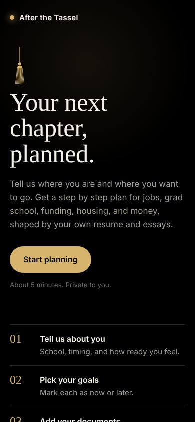
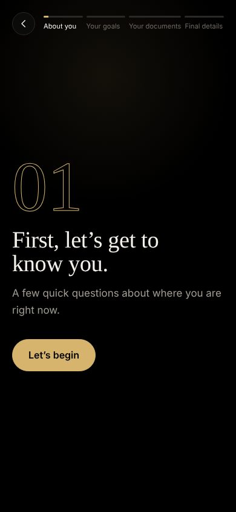

# After the Tassel

**A post grad planner for everyone**

**Live demo:** https://afterthetassel.netlify.app/  
**Status:** In progress · **Built at:** Personal

 

## Overview
Tell it where you are and where you want to go, and get a step by step plan for jobs, grad school, funding, housing and money, shaped by your own resume and essays.

## What I built
A one question per page flow covering school, timing and readiness; goals you mark as now or later; uploads for resumes, cover letters and essays; and a generated plan with steps, a timeline, feedback and answers. It takes about five minutes and stays private to you.

## My role
Solo project: research, UX flows, design and build.

## Security and privacy
* The Claude API key lives in Netlify environment settings and is only used by the edge function, never in the browser.
* Answers and uploaded documents stay in the visitor's own browser.

## Tech
HTML, CSS, JavaScript, Netlify Edge Functions, Claude API

## Run it
Deploy to Netlify and set `ANTHROPIC_API_KEY` in the site settings. See [SETUP.md](SETUP.md).

## What's next
Open it to classmates graduating in 2027 and collect feedback on the plans it writes.

---
Built by **Taseyana Booker-Hopkins** · Computer Information Systems (cybersecurity), Georgia State University · [Portfolio](https://taseyanab.github.io) · [LinkedIn](https://linkedin.com/in/taseyana)
